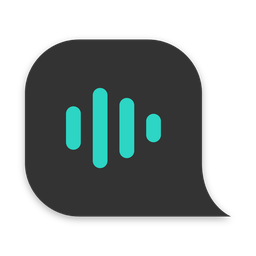

<p align="center">
  
</p>

<h1 align="center">Sprechwerk</h1>

<p align="center">
  <b>Sprechen statt tippen, mit dem Wortschatz von Schaltwerk.</b><br>
  Diktieren auf dem Mac, komplett auf dem Mac. Der interne Fork von
  <a href="https://github.com/cmagnussen/blitztext-app">Blitztext</a> für Schaltwerk Digital.
</p>

> **Sprechwerk basiert auf [Blitztext](https://github.com/cmagnussen/blitztext-app) von
> Blackboat.** App, Spracherkennung, Modi und Meetings stammen aus Blitztext. Schaltwerk hat
> den Team-Wortschatz und das eigene Branding ergänzt. Danke an Blackboat und alle, die zu
> Blitztext beigetragen haben. Mehr unter [Credits](#credits).

Kürzel halten, sprechen, loslassen. Sprechwerk schreibt den Text dort hin, wo der Cursor
steht: in Claude, Slack, ClickUp, Missive, Outlook oder jedes andere Feld. Die Spracherkennung
läuft auf dem Mac, der Ton verlässt das Gerät nicht.

## Was Sprechwerk zusätzlich zu Blitztext kann

- **Team-Wortschatz aus dem Brain:** Kunden, Tools und Namen, die alle bei Schaltwerk
  diktieren, liegen als Markdown im Vault (`agency/schaltwerk/team-wortschatz.md`). Sprechwerk
  findet die Datei selbst, liest sie bei Änderungen neu und korrigiert damit jedes Diktat,
  jeden KI-Modus, Audiodateien und Meetings.
- **Persönlich plus Team:** das eigene Wörterbuch bleibt und geht vor. Neue Begriffe lassen
  sich in den Einstellungen wahlweise nur für sich oder fürs ganze Team speichern.
- **Kontext fürs Team:** der Abschnitt „Kontext“ der Datei beschreibt Schaltwerk für die
  KI-Modi, solange jemand keinen eigenen Kontext eingetragen hat.
- **Kurze Prompts trotz langer Liste:** an das Sprachmodell gehen nur die Team-Begriffe, die
  im Diktat vorkommen. So bleibt Apple Intelligence auf dem Mac schnell.
- Eigener Name, eigenes Icon, eigene Bundle-ID. Sprechwerk und Blitztext stören sich nicht.

## Installieren

```bash
curl -fsSL https://raw.githubusercontent.com/schaltwerkdigital/sprechwerk/main/install.sh | bash
```

Dieselbe Zeile aktualisiert eine bestehende Installation. Ist das Repository privat, geht es
mit angemeldetem `gh` (`gh auth login`) oder mit einer ZIP aus den Releases:
`./install.sh ~/Downloads/Sprechwerk.zip`.

Danach führt der Einrichtungsassistent durch:

1. **Mikrofon** erlauben.
2. **Bedienungshilfen** erlauben (zum Einfügen in andere Apps).
3. **Sprachmodell** laden: Parakeet Ultra, einmalig ca. 630 MB.
4. Beim ersten Start fragt macOS, ob Sprechwerk auf „Dokumente“ zugreifen darf. Das braucht
   es für den Team-Wortschatz im Brain.

**Voraussetzungen:** macOS 14 oder neuer, Apple Silicon empfohlen. Die KI-Modi brauchen
macOS 26 mit Apple Intelligence oder einen eigenen API-Key.

## Kürzel

| Modus | Kürzel | Was passiert |
|---|---|---|
| **Sprechwerk** | `fn + Shift` | Sprache wortgenau als Text, ideal für Claude-Prompts |
| **Sprechwerk+** | `fn + Control` | Gesprochenes als sauberer Schrifttext, gut für Mails |
| **Sprechwerk $%&!** | `fn + Option` | Frust rein, ruhige Nachricht raus |
| **Sprechwerk :)** | `fn + Cmd` | Text mit passenden Emojis |

Ohne `fn`-Taste (externe Tastaturen) eigene Kürzel in den Einstellungen setzen. Unter
**Modi > Modus je App** lässt sich z. B. Outlook immer auf Sprechwerk+ stellen.

## Team-Wortschatz pflegen

Die Liste liegt im Brain unter `agency/schaltwerk/team-wortschatz.md` und wird in Obsidian
bearbeitet. Mit dem Vault-Sync ist sie auf jedem Mac, Sprechwerk liest sie spätestens beim
nächsten Diktat neu.

```markdown
## Begriffe
- Velomanufaktur
- Abacus (Schweizer ERP)

## Ersetzungen
- Schenobel, Schenobl → Channable

## Kontext
Schaltwerk Digital ist eine E-Commerce-Agentur ...
```

- **Begriffe** werden auch dann richtig geschrieben, wenn die Erkennung sie leicht verhört
  („Felomanufaktur“ wird „Velomanufaktur“). Echte Wörter bleiben unangetastet.
- **Ersetzungen** greifen immer, wenn genau diese Wörter fallen. Deshalb nur für Verhörer, die
  kein echtes Wort sind („Cloud“ gehört nicht hierher).
- Eine Notiz in Klammern am Zeilenende wird ignoriert, aus „Abacus (Schweizer ERP)“ wird „Abacus“.
- `###`-Überschriften gruppieren nur. Kommentare als `<!-- -->`.

Liegt der Vault woanders, sucht Sprechwerk auch in allen Vaults, die Obsidian kennt. Unter
**Einstellungen > Wörterbuch > Team-Wortschatz** lässt sich die Datei auch von Hand wählen.

## Updates

Neue Versionen holt dieselbe Installationszeile. Weil Sprechwerk nicht bei Apple notarisiert
ist, kann macOS danach die Freigabe zum Einfügen verlieren: **Einstellungen > Allgemein >
Freigabe zurücksetzen** und Sprechwerk in den Bedienungshilfen wieder einschalten.

## Entwickeln

```bash
brew install xcodegen
./build.sh --install --run          # braucht Xcode 26
```

Mit `SPRECHWERK_SIGN_IDENTITY="<Zertifikat>"` signiert `build.sh` fest, dann überleben die
Freigaben Neubauten.

**Release:** Tag pushen (`git tag v1.0.1 && git push origin v1.0.1`). GitHub Actions baut die
App auf macOS 26 und hängt `Sprechwerk.zip` an das Release. Vorher in
`BlitztextMac/project.yml` `MARKETING_VERSION` und `CURRENT_PROJECT_VERSION` erhöhen.

**Blitztext-Updates übernehmen:**

```bash
git fetch upstream
git merge upstream/main
```

Danach `SprechwerkBrand.upstreamVersion` anpassen. Konflikte entstehen meist nur in Texten,
in denen „Blitztext“ durch „Sprechwerk“ ersetzt ist. Den Sparkle-Feed von Blitztext nie
übernehmen, er würde Sprechwerk durch Blitztext ersetzen.

Die Ordner heißen weiter `BlitztextMac` und `BlitztextShared`, damit Merges klein bleiben.
Die Team-Funktionen liegen in `Services/TeamVocabulary.swift`,
`Services/TeamVocabularyStore.swift` und `Features/Settings/TeamVocabularySection.swift`.

## Datenschutz

```text
Spracherkennung:   auf dem Mac (Parakeet oder Whisper)
KI-Modi:           auf dem Mac (Apple Intelligence)
                   oder ein eigener Anbieter mit eigenem API-Key, wenn eingetragen
Meetings:          auf dem Mac, nie bei einem Anbieter
Team-Wortschatz:   Datei im Brain-Vault, wird nur gelesen (und auf Wunsch ergänzt)
Modell-Download:   Hugging Face, einmal je Modell
```

Sprechwerk hat kein Backend und sammelt keine Daten. Details in [docs/privacy.md](docs/privacy.md).

## Credits

**[Blitztext](https://github.com/cmagnussen/blitztext-app)** von **Blackboat** ist die Grundlage
von Sprechwerk: Konzept, App und fast der gesamte Code. Sprechwerk folgt der Einladung von
Blitztext, den Code zu nutzen, anzupassen und weiterzugeben. Danke an Blackboat und an alle
[Beitragenden von Blitztext](https://github.com/cmagnussen/blitztext-app/graphs/contributors),
deren Pull Requests die App geprägt haben, darunter die automatischen Absätze, Build-Korrekturen
und der Abbruch-Fix.

Blitztext und damit auch Sprechwerk stehen auf den Schultern von:

- **[FluidAudio](https://github.com/FluidInference/FluidAudio)**, **Moondream** und **NVIDIA**
  für Parakeet Ultra auf Core ML
- **[WhisperKit](https://github.com/argmaxinc/argmax-oss-swift)** von Argmax und **OpenAI**
  für Whisper
- **[Sparkle](https://sparkle-project.org)** für Updates
- **Google** für Gemma 4 und **[MLX](https://github.com/ml-explore/mlx-swift)**, das es auf dem Mac
  laufen lässt
- **[Public Sans](https://github.com/uswds/public-sans)** als Schrift
- der **Open-Source-Diktier-Community**, die Blitztext mit inspiriert hat

Was Schaltwerk ergänzt hat: Team-Wortschatz aus dem Brain, Zusammenführung mit dem
persönlichen Wörterbuch, kürzere KI-Prompts, eigenes Branding, Installer und Release-Workflow.

Sprechwerk wird von Schaltwerk Digital betreut, nicht von Blackboat. Fehler bitte hier melden,
nicht bei Blitztext. Was allgemein nützlich ist, geben wir gern als Pull Request an Blitztext
zurück.

## Lizenz

MIT, siehe [LICENSE](LICENSE). Der Copyright-Vermerk von Blitztext bleibt erhalten, die
Änderungen von Schaltwerk stehen unter derselben Lizenz.

Name, Logo und Icon von Blitztext sind nicht Teil der Lizenz, deshalb hat der Fork eigene
(siehe [TRADEMARKS.md](TRADEMARKS.md)). Lizenztexte aller Bestandteile:
[THIRD_PARTY_NOTICES.md](THIRD_PARTY_NOTICES.md), auch in der App unter Einstellungen >
Allgemein > Über Sprechwerk > Lizenzen und Hinweise.
